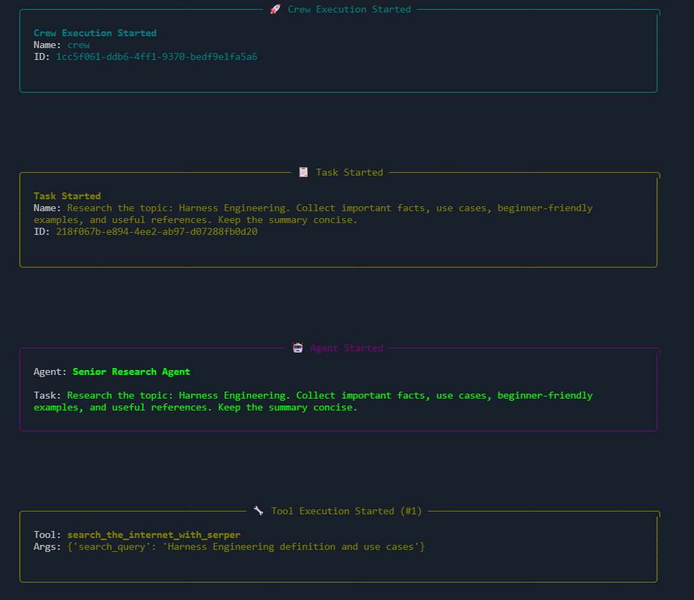
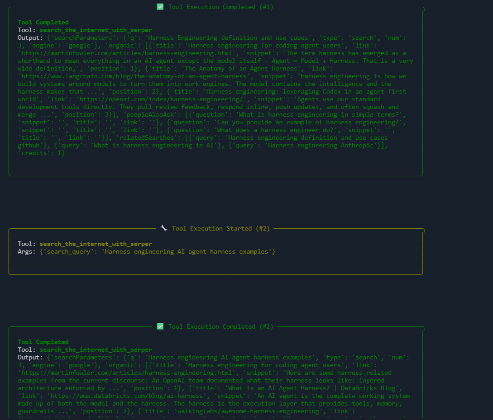
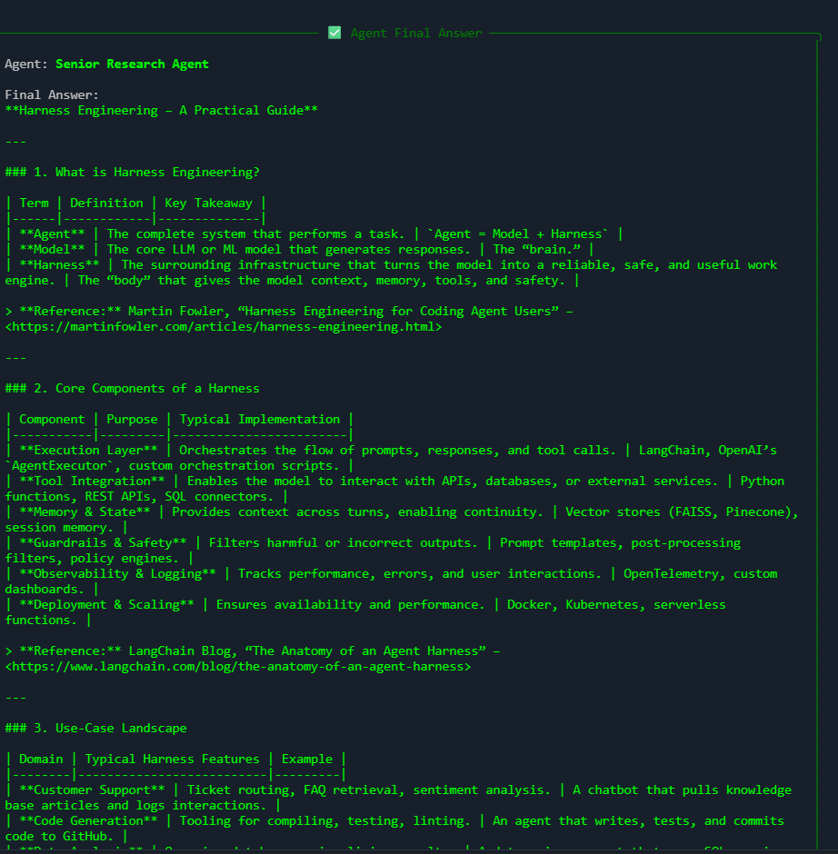
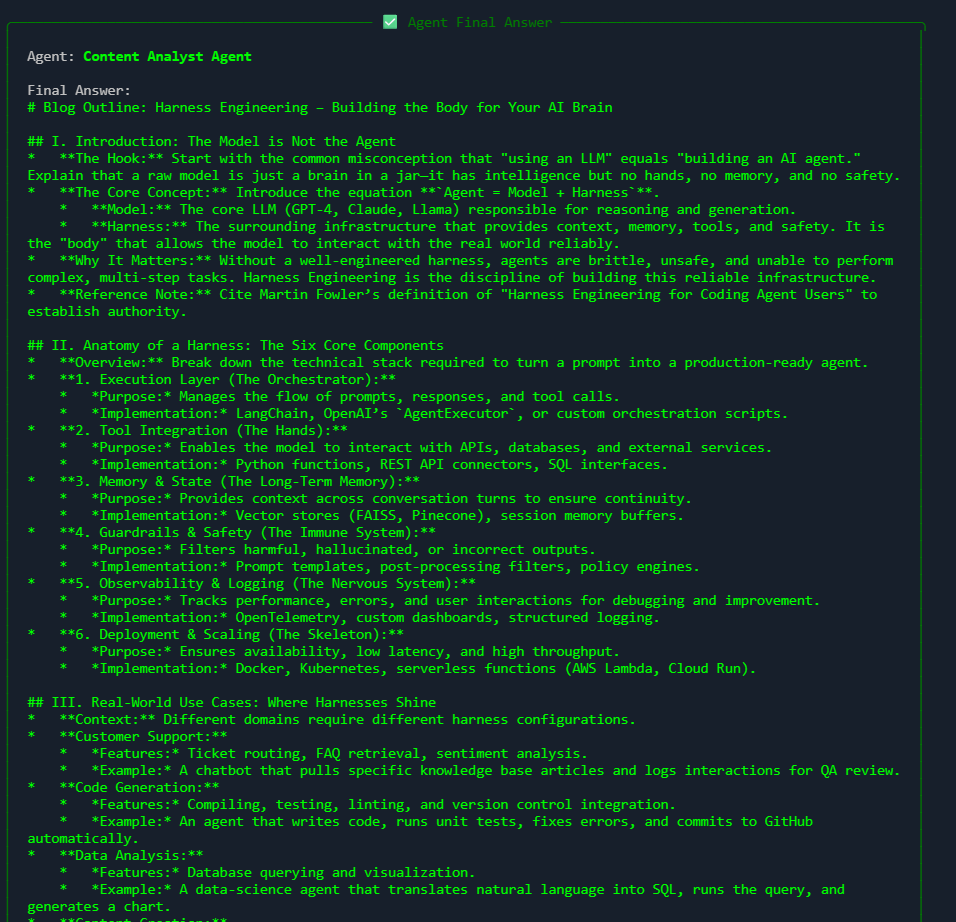
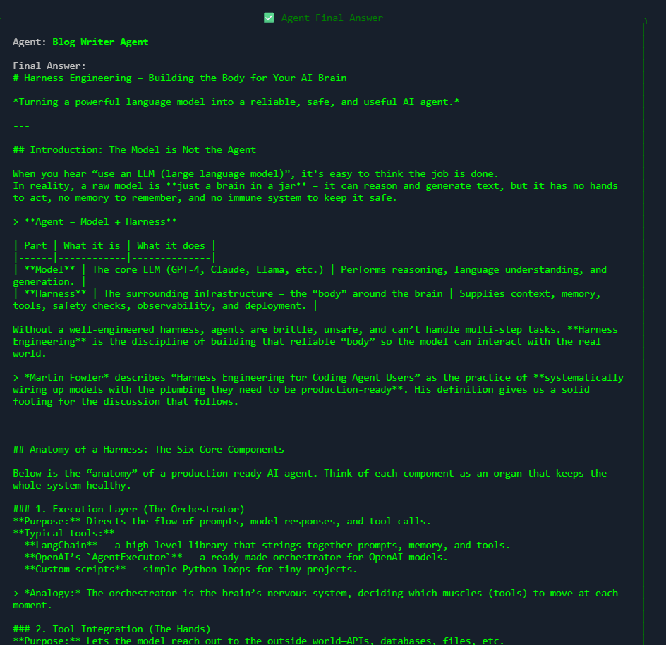
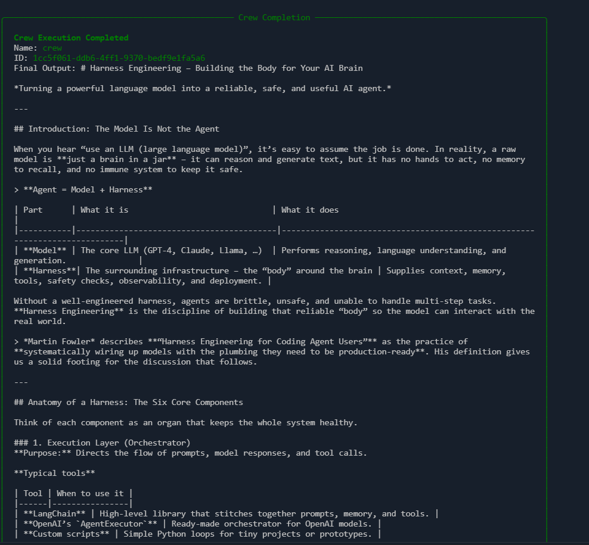

# 🚀 CrewAI Blog Generator


**AI-Powered Multi-Agent Blog Generator** — Research any topic and turn it into a polished, beginner-friendly Markdown blog post using a sequential CrewAI pipeline.

---

## 📖 Overview

**CrewAI Blog Generator** is an agentic AI workflow built in a Jupyter Notebook that automates the end-to-end content creation lifecycle. Instead of manually researching topics, structuring outlines, drafting sections, and editing articles, users simply enter a topic and a coordinated team of four specialized AI agents handles the entire process.

Powered by **Groq-hosted LLMs** for ultra-fast inference and **Serper** for real-time web search, the system outputs a clean, publication-ready blog post in Markdown.

---

## ✨ Features

- 🤖 **Multi-Agent Collaboration:** Four specialized agents working sequentially via CrewAI.
- 🔍 **Real-Time Web Research:** Automated fact-gathering, examples, and citations using Serper API.
- 🗂️ **Structured Outlining:** Converts raw search results into a logical, beginner-friendly article blueprint.
- ✍️ **Automated Drafting:** Generates engaging, well-formatted Markdown content from the outline.
- 🧹 **Built-in Editorial Polish:** Dedicated editor agent refines clarity, tone, and readability.
- ⚡ **Ultra-Fast Inference:** Leverages Groq-hosted language models for rapid execution.
- 📓 **Interactive Jupyter Workflow:** Easy-to-run notebook setup with step-by-step execution logs.

---

## 🛠 Tech Stack

| Layer | Technologies |
| :--- | :--- |
| **Agent Framework** | CrewAI, CrewAI Tools |
| **LLM Provider** | Groq API |
| **Web Search Tool** | Serper API |
| **Environment** | Python 3.10+, Jupyter Notebook, `python-dotenv` |

---

## 🏗 Architecture

```text
User Input (Blog Topic)
        │
        ▼
1. Senior Research Agent ──► Serper Web Search API
        │
        ▼
2. Content Analyst Agent (Structured Outline)
        │
        ▼
3. Blog Writer Agent (Markdown Draft)
        │
        ▼
4. Editor Agent (Clarity & Flow Polish)
        │
        ▼
Final Publication-Ready Markdown Blog Post
```

---

## 📂 Project Structure

```text
CrewAI-blog-project/
├── screenshots/
│   ├── 01-crew-research-start.png
│   ├── 02-web-search-results.png
│   ├── 03-research-summary.png
│   ├── 04-blog-outline.png
│   ├── 05-blog-draft.png
│   └── 06-final-blog-output.png
├── .gitignore
├── README.md
└── crewai_blog_project.ipynb
```

---

## 🚀 Getting Started

### 1. Clone the repository
```bash
git clone [https://github.com/Ganeshmangilipelli/CrewAI-blog-project.git](https://github.com/Ganeshmangilipelli/CrewAI-blog-project.git)
cd CrewAI-blog-project
```

### 2. Set up a virtual environment (Recommended)
```bash
python -m venv .venv

# Windows
.venv\Scripts\activate

# macOS / Linux
source .venv/bin/activate
```

### 3. Install dependencies
Run the first cell inside `crewai_blog_project.ipynb` or install via terminal:
```bash
pip install crewai crewai-tools python-dotenv
```

### 4. Configure environment variables
Create a `.env` file in the root directory and add your API keys:
```env
GROQ_API_KEY=your_groq_api_key
SERPER_API_KEY=your_serper_api_key
```
> **Security Note:** Never commit your `.env` file. It is excluded from Git via `.gitignore`.

### 5. Run the notebook
1. Open `crewai_blog_project.ipynb` in VS Code or Jupyter Notebook.
2. Execute the cells in sequential order.
3. Enter your desired blog topic when prompted.
4. View the final edited Markdown blog post printed at the end of the run.

---

## 💡 Why CrewAI Blog Generator?

Creating well-researched technical content requires switching between searching, outlining, writing, and editing. **CrewAI Blog Generator** demonstrates how autonomous AI agents can divide complex cognitive tasks into a reliable, repeatable pipeline—turning a single prompt into a structured article in seconds.

---

## 🎯 Future Improvements

- [ ] Export generated posts directly to `.md` or `.html` files
- [ ] Add an SEO Optimization Agent for meta descriptions and keywords
- [ ] Support custom tone and target audience selection
- [ ] Build a Streamlit or React web interface
- [ ] Add automated fact-checking and source link verification

---

## 📸 Screenshots

### 1. Crew Starts Researching


### 2. Web Search Results


### 3. Research Output


### 4. Blog Outline


### 5. Blog Draft


### 6. Completed Blog


---

## 👨‍💻 Author

**Ganesh Mangilipelli**  
B.Tech – Computer Science & Engineering (Cyber Security)  
`AI` • `Agentic AI` • `MERN Stack` • `Machine Learning` • `Generative AI`

- **GitHub:** [@Ganeshmangilipelli](https://github.com/Ganeshmangilipelli)
- **LinkedIn:** [Connect on LinkedIn](https://linkedin.com/in/your-linkedin-profile)

---

## ⭐ Support

If you found this project helpful, please consider supporting it:
- ⭐ **Star** the repository
- 🍴 **Fork** the project
- 💬 **Share** your feedback

> *"Orchestrating autonomous AI agents to turn ideas into structured knowledge."*
